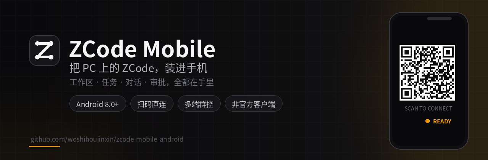
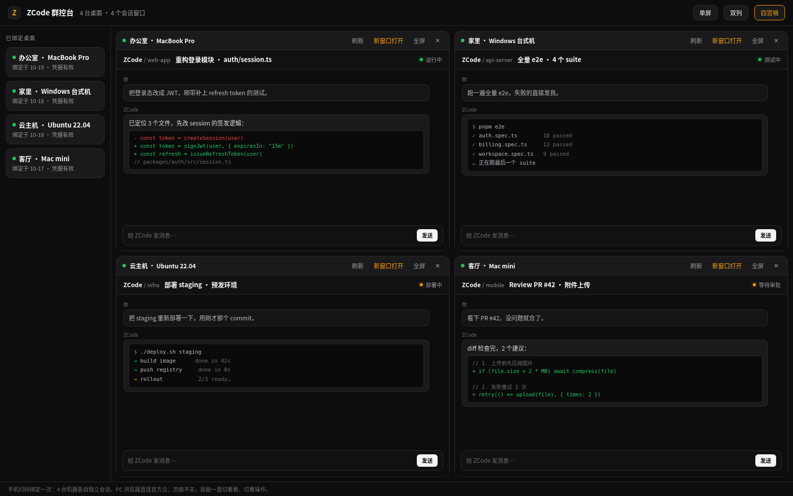
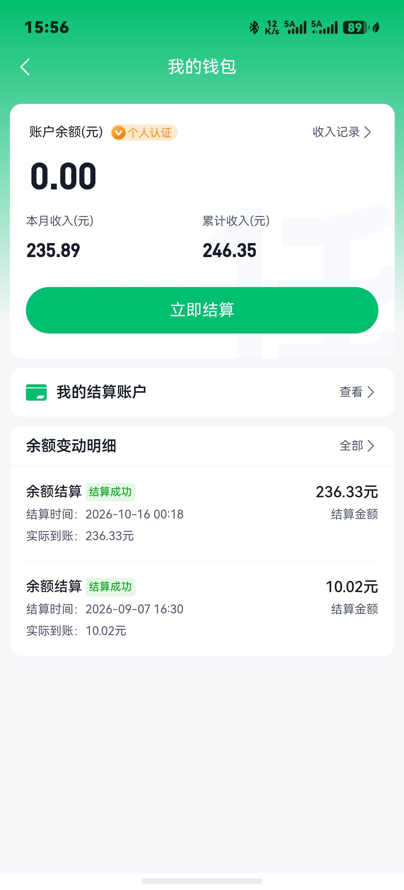
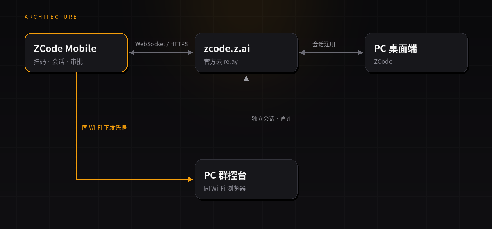

<!--
  说明：
  - 推广链接取自海报二维码（任推邦邀请码 3837565）；如需更换团长链接，替换下方所有 URL。
  - 收益截图、微信/支付宝收款码均在 assets/ 下，替换同名文件即可更新。
  - APK 位于 releases/，README 顶部与下载区均指向 main 分支的 raw 链接。
-->

<p align="center">
  
</p>

<p align="center">
  手机扫码，接管 PC 上的 ZCode。<br>
  工作区、任务、流式对话、权限审批，一块屏幕全搞定。
</p>

<p align="center">
  <a href="https://github.com/woshihoujinxin/zcode-mobile-android/raw/main/releases/zcode-mobile-0.6.1.apk">
    
  </a>
  
  
</p>

---

<p align="center">
  <a href="assets/promo-multimachine.png"></a>
</p>
<p align="center"><sub>PC 群控台 · 多机同屏：四台机器、四个独立会话，单屏 / 双列 / 四宫格随时切换（演示数据，点击看大图）</sub></p>

## 📲 下载安装

**v0.6.1** · Android 8.0+ · 约 5.7 MB · debug 签名

<p align="center">
  <a href="https://github.com/woshihoujinxin/zcode-mobile-android/raw/main/releases/zcode-mobile-0.6.1.apk"><b>⬇️ 下载 zcode-mobile-0.6.1.apk</b></a>
</p>

> 首次安装需允许「安装未知来源应用」；体验包使用 debug 签名，如需公开分发请替换为正式签名。

## 🚀 三分钟上手

1. PC 端 ZCode 打开任一工作区，点「Web 远程控制」，生成配对二维码。
2. 手机 App 首页点「扫码连接桌面端」，授权相机后扫码。
3. 进入会话页，即可查看任务、接管对话、处理权限审批。

> 也可以在 PC 端点「复制链接」，把链接发到手机，点开即可直接绑定。

## ✨ 核心能力

| | 能力 | 说明 |
| :---: | --- | --- |
| 📱 | 一机多桌面 | 同时绑定多台 PC，设备列表一键切换；重扫自动更新配对凭据 |
| 🔗 | 三种绑定 | 扫码、粘贴链接、深链接跳转，换手机也不用重新折腾 |
| 💬 | 完整会话 | WebView 承载官方手机页：工作区、任务、流式对话、权限审批、附件上传 |
| 🖥 | PC 群控台 | 手机作锚点，同一 Wi-Fi 的 PC 浏览器直连官方云，单屏/双列/四宫格 |
| 🩺 | 连接自愈 | 凭据探针 + 断线重连；桌面重置配对后重扫即恢复 |
| 🔒 | 安全边界 | 凭据仅存本机；https + 官方域名白名单 + sid/hash 校验 |

## 🙌 推广（广告 · 不喜欢请跳过）

**说真的，这是最适合程序员干的副业了。**

职场卷不动，不如开辟新赛道：APP 拉新推广，不用囤货、不用坐班，扫码进团就能开始，跑通了就是躺赚。

<p align="center">
  <a href="https://tg.bd.cn/#/pages/login/register?invite_code=3837565&qd=self_team_android"></a>
  &nbsp;&nbsp;
  
</p>
<p align="center"><sub>左：推广海报　·　右：真实收益截图</sub></p>

<p align="center">
  <a href="https://tg.bd.cn/#/pages/login/register?invite_code=3837565&qd=self_team_android"><b>→ 扫码或点这里，进团查看项目详情</b></a>
</p>

> 平台 500+ 项目、佣金置顶、不收入驻/做单费用。以上为广告内容，**不感兴趣请直接跳过**，不影响项目任何功能；收益因人而异，请理性参与。

<details>
<summary>查看更多推广海报</summary>
<p align="center">
  <a href="https://tg.bd.cn/#/pages/login/register?invite_code=3837565&qd=self_team_android"></a>
  &nbsp;&nbsp;
  <a href="https://tg.bd.cn/#/pages/login/register?invite_code=3837565&qd=self_team_android"></a>
</p>
<p align="center">
  <a href="https://tg.bd.cn/#/pages/login/register?invite_code=3837565&qd=self_team_android"></a>
  &nbsp;&nbsp;
  <a href="https://tg.bd.cn/#/pages/login/register?invite_code=3837565&qd=self_team_android"></a>
</p>
</details>

## 🖥 PC 群控台

手机先作为「已认证锚点」，把配对凭据下发给同一 Wi-Fi 的 PC 浏览器；PC **直连官方云**建立独立会话，与手机互不转发。

一次绑定多台桌面后，PC 浏览器打开群控台即可 **多机同屏**：每台机器一个独立会话，单屏 / 双列 / 四宫格随意切；页面不关，就能一直连着多台机器，不用来回切窗口。

1. App 首页点「PC 群控」→ 启动服务。
2. 在同一 Wi-Fi 的 PC 浏览器打开 App 显示的地址。
3. 点任一设备格子即可独立操作，支持单屏 / 双列 / 四宫格。

## 🏗 技术架构

<p align="center">
  
</p>

## 🛠 构建

> JDK 17+ · Android SDK 34

```bash
git clone https://github.com/woshihoujinxin/zcode-mobile-android.git
cd zcode-mobile-android
./gradlew assembleDebug
```

产物：`app/build/outputs/apk/debug/app-debug.apk`

技术栈：Java 17 · AndroidX · Material Components · ZXing · WebView

## 🤝 反馈与贡献

遇到问题、想要新功能，欢迎提 [Issue](https://github.com/woshihoujinxin/zcode-mobile-android/issues)；Pull Request 同样欢迎。

## ☕ 打赏支持

如果这个项目帮你节省了时间，欢迎扫码打赏，支持后续维护。**完全自愿，不打赏也不影响任何功能。**

<p align="center">
  
  &nbsp;&nbsp;&nbsp;&nbsp;
  
</p>
<p align="center"><sub>左：微信支付　·　右：支付宝</sub></p>

<p align="center">
  <sub>如果这个项目帮到了你，点个 ⭐ <a href="https://github.com/woshihoujinxin/zcode-mobile-android">Star</a> 就是最好的支持</sub>
</p>

## 🤝 个人微信 · 建联方式

程序员兄弟们，一块学习啊，了解真实的世界。

<p align="center">
  
</p>

---

<p align="center">
  <sub>非官方客户端，与 Z.ai 无隶属关系 · 仅连接官方 <code>zcode.z.ai</code> 服务</sub><br>
  <sub>Made with ☕ by <a href="https://github.com/woshihoujinxin">@woshihoujinxin</a></sub>
</p>
